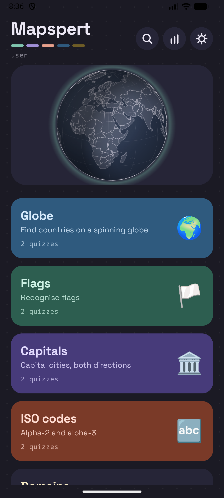
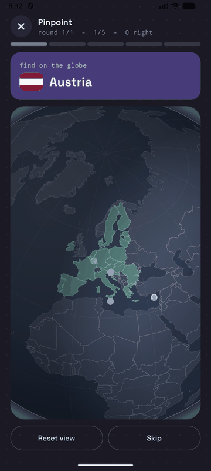
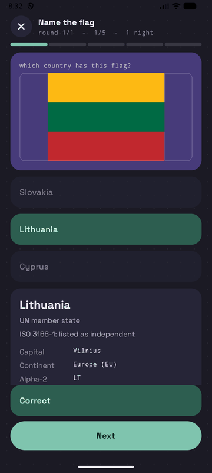

<div align="center">


# Mapspert

**An offline geography quiz for Android. No ads, no tracking, no accounts.**

</div>

---

> **Status: work in progress.** Mapspert is in early development and is not yet
> published on F-Droid. Expect rough edges.

## Screenshots

<div align="center">
<table>
<tr>
<td align="center"></td>
<td align="center"></td>
<td align="center"></td>
</tr>
<tr>
<td align="center"><sub>Home</sub></td>
<td align="center"><sub>Pinpoint</sub></td>
<td align="center"><sub>Name the flag</sub></td>
</tr>
</table>
</div>

## What it does

Spin an interactive globe and tap the country you are asked for, or practise
flags, capitals, ISO 3166-1 codes and country top-level domains.

| Category | Quizzes |
| --- | --- |
| Globe | Pinpoint on the globe, name the outline |
| Flags | Name the flag, find the flag |
| Capitals | Country to capital, capital to country |
| ISO codes | Alpha-2, alpha-3 |
| Domains | Internet top-level domains |

The globe is drawn as an orthographic projection on a plain Compose canvas —
no 3D engine and no extra dependencies. Drag to spin, pinch to zoom; countries
too small to hit at a given zoom appear as tappable dots.

Each round can be set to a region (world, Europe, EU, Africa, Asia, North
America, South America, Oceania) and a difficulty:

- **Easy** — the 193 UN member states, three options
- **Medium** — members plus the two observer states, four options
- **Hard** — all 250 entries including territories, four options

Rounds are 5, 10, 20 or all countries in the pool, and a session runs 1, 3 or 5
rounds. Practice weighting makes countries you get wrong come up more often.

## Statistics

Every finished round is stored with its date, mode, region, difficulty, score
and answering time. The statistics screen charts accuracy or seconds per
question with a five-round average, breaks results down by category and by
quiz, and lists your strongest and weakest countries. Entering a player name
keeps a friend's round out of your own numbers.

Nothing leaves the device: the app declares no network permission at all.

## Data

The country list follows **ISO 3166-1** — 249 officially assigned alpha-2
codes, plus Kosovo under the user-assigned code `XK`. Status labels
("independent", "not independent", disputes) repeat what ISO 3166-1 lists and
are not a political statement.

| Content | Source | Licence |
| --- | --- | --- |
| Names, capitals, codes, domains | [Wikidata](https://www.wikidata.org) | CC0 1.0 |
| Country outlines | [Natural Earth](https://www.naturalearthdata.com) 10m map units | public domain |
| Flags | [flag-icons](https://github.com/lipis/flag-icons) | MIT |
| Font | [Space Grotesk](https://github.com/floriankarsten/space-grotesk) | SIL OFL 1.1 |
| Icon | this project | GPL-3.0-or-later |

Map borders in disputed areas follow Natural Earth's own rendering.

Both data files are generated and committed. `data/README.md` records the exact
commands, and `docs/DATA_VERIFICATION.md` separates what is sourced from the
hand-made decisions (capital ordering, continent assignments, a few domains)
and what still needs verifying.

```sh
python3 tools/build_countries.py data/wikidata_countries.csv \
    app/src/main/assets/countries.json data/wikidata_tld.csv <flag-icons country.json>
python3 tools/build_map.py <ne_10m_admin_0_map_units.geojson> \
    app/src/main/assets/countries.json app/src/main/assets/map.bin
```

`tools/build_map.py` simplifies borders topologically — shared arcs are
extracted and simplified once, so neighbouring countries keep matching edges —
and writes a compact binary with two levels of detail, one for hit-testing and
a coarser one for drawing.

## Building

Requires Android Studio (or the Android SDK) with JDK 17 or later.

```sh
git clone https://github.com/AgentGit007/mapspert.git
cd mapspert
./gradlew assembleDebug
```

The APK lands in `app/build/outputs/apk/debug/`. There are no dependencies
beyond AndroidX and Jetpack Compose, and nothing is fetched at runtime.

Built for F-Droid: the dependency-metadata block is disabled in
`app/build.gradle.kts`, and the `foojay-resolver-convention` plugin is removed
from `settings.gradle.kts`. See `docs/FDROID.md` for the full checklist.

## Project layout

```
app/src/main/java/app/mapspert/
    quiz/         question generation, map geometry, globe maths, statistics
                  (pure Kotlin, no Android imports)
    ui/           Compose screens
    Storage.kt    settings and statistics (SharedPreferences)
app/src/main/assets/
    countries.json, map.bin
data/, tools/     data sources and the scripts that generate the assets
```

Everything in `quiz/` is free of Android imports so it can be tested on the JVM.

## Contributing

Issues and pull requests are welcome. Corrections to the country data are
especially useful — see the list of hand-made decisions in
`docs/DATA_VERIFICATION.md`.

## Licence

GPL-3.0-or-later. See [LICENSE](LICENSE).

Made with Natural Earth. Free vector and raster map data at
[naturalearthdata.com](https://www.naturalearthdata.com).
